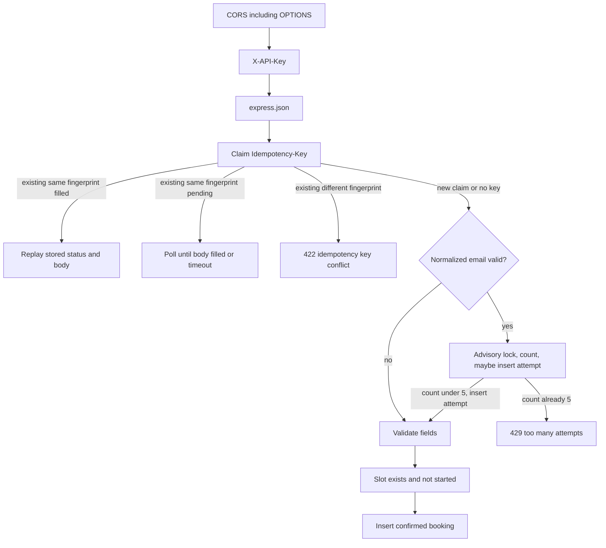

# Clinic booking API and web — execution plan

Two public repos. Form URL is the API. API README links the web repo. No `/api` prefix. Browser calls the API with `X-API-Key`. Freeze after the last production test.

## Locked request pipeline

Middleware order on the Express app: **CORS, then auth, then `express.json`**. Preflight `OPTIONS` skips auth. `GET /health` skips auth. Missing/wrong key therefore returns **401 even for malformed JSON**. Bad JSON with a valid key returns **400** `invalid json`.

Then for `POST /bookings`:



- Auth miss: **401**, not rate-limited, not parsed.
- Replay (including after poll): **do not** take a rate-limit lock or insert an attempt.
- Rate limit only if email is present, trimmed, lowercased, and passes the format check.
- Count failed attempts that have a valid email (missing name, unknown slot, started slot, 409, etc.).
- **Do not insert a `booking_attempts` row for 429.** Waiting out `Retry-After` must be able to succeed.
- Idempotency: claim the key first. On **429 or 500**, **delete the claim** so the client can retry. Persist every other completed response (201/400/404/409/422) on the claim.

## Stack and layout

**API** ([clinic-booking-api](C:\Users\PC\clinic-booking\clinic-booking-api)): Node 20, Express, TypeScript (plain `src/` files, no DI/framework soup), `pg`, `tsx` for dev, `node:test` + supertest for contract tests.

```
src/index.ts          listen
src/app.ts            CORS, then auth, then express.json
src/config.ts         env (prod vs test DB)
src/db.ts             pool
src/schema.ts         apply sql/schema.sql on boot
src/ids.ts            uuid for booking ids
src/time.ts           ISO format: omit .000 when ms are zero
src/http/errors.ts    sendError helpers
src/http/auth.ts      X-API-Key except OPTIONS and GET /health
src/http/cors.ts
src/routes/reset.ts
src/routes/slots.ts
src/routes/bookings.ts
src/lib/email.ts
src/lib/idempotency.ts
src/lib/ratelimit.ts
sql/schema.sql
scripts/seed.ts
tests/*.test.ts
.env.test.example
```

**Web** ([clinic-booking-web](C:\Users\PC\clinic-booking\clinic-booking-web)): Vite, plain JS, one page.

**Hosts:** Neon (Postgres) + Render Web Service (API) + Vercel (web). Uptime: keep `GET /health`; **UptimeRobot every 5 minutes** is the main pinger (GitHub Actions cron is not used).

---

## Database (`sql/schema.sql`)

Apply on boot with `CREATE TABLE IF NOT EXISTS` / `CREATE INDEX IF NOT EXISTS`. `/reset` truncates data, not schema.

**`end` is reserved in Postgres.** Use `start_ts` / `end_ts` and map to JSON `start` / `end`.

- **slots:** `id TEXT PRIMARY KEY`, `provider TEXT NOT NULL`, `start_ts TIMESTAMPTZ NOT NULL`, `end_ts TIMESTAMPTZ NOT NULL`
- **bookings:** `id TEXT PRIMARY KEY`, `slot_id TEXT NOT NULL REFERENCES slots(id) ON DELETE CASCADE`, `name TEXT NOT NULL`, `email TEXT NOT NULL`, `status TEXT NOT NULL CHECK (status IN ('confirmed','cancelled'))`, `created_at TIMESTAMPTZ NOT NULL DEFAULT now()`, `seq BIGSERIAL NOT NULL`
- **Partial unique index:** `UNIQUE (slot_id) WHERE status = 'confirmed'`
- Indexes: `bookings (email, seq)`, `slots (start_ts)`
- **`seq` is never exposed** in JSON. It exists only for stable pagination.
- **idempotency_keys:** `key TEXT PRIMARY KEY`, `fingerprint TEXT NOT NULL`, `status_code INT NULL`, `body JSONB NULL`, `created_at TIMESTAMPTZ NOT NULL DEFAULT now()`. A row with `status_code IS NULL` is an in-flight claim.
- **booking_attempts:** `id BIGSERIAL PRIMARY KEY`, `email TEXT NOT NULL`, `attempted_at TIMESTAMPTZ NOT NULL DEFAULT now()` plus index on `(email, attempted_at)`

`POST /reset` in one transaction: delete/truncate bookings, idempotency_keys, booking_attempts, slots; then insert posted slots (including past times) into `start_ts`/`end_ts`.

---

## Timestamps

Helper formats every `date-time` field (`start`, `end`, `created_at`):

- Always UTC with `Z`.
- If milliseconds are **zero**, omit them: `2026-12-10T09:00:00Z` (spec examples).
- If milliseconds are non-zero, include three digits.

---

## Error strings (never change after freeze)

All bodies: `{"error":"<string>"}`.

- `unauthorized` — 401 missing/wrong `X-API-Key`
- `invalid json` — 400 malformed body **with a valid key**
- `invalid slots` — 400 `POST /reset` when `slots` missing or not an array
- `invalid booking` — 400 missing/empty `slot_id`/`name`/`email` or invalid email format
- `slot not found` — 404 book unknown slot
- `slot already started` — 400 `now >= slot.start_ts`
- `slot already booked` — 409 confirmed booking exists (including unique-violation race)
- `booking not found` — 404 get/cancel unknown id
- `already cancelled` — 409 delete
- `idempotency key conflict` — 422
- `too many attempts` — 429
- `invalid limit` — 400 `limit` present and not an integer 1–50
- `invalid email` — 400 `GET /bookings` missing/empty/invalid email query
- `invalid cursor` — 400 bad `cursor`
- `not found` — 404 unknown route
- `internal error` — 500 (including idempotency poll timeout)

`POST /reset` success: **200** `{"ok": true}`.

---

## Endpoint behaviour

Global (from Level 2 onward, except as noted):

- `GET /health` — **no API key**, 200 `{"ok": true}` (Render + UptimeRobot)
- `OPTIONS *` — CORS, **no API key**
- Else missing/wrong key → 401 (before JSON parse)
- CORS: `Access-Control-Allow-Origin` for the Vercel origin (also allow `*` in dev). Allow headers `Content-Type, X-API-Key, Idempotency-Key`. **Expose `Retry-After`**.

**POST /reset** — replace catalog. 400 if `slots` missing or not an array. Empty array is allowed (clears catalog). Slot objects must have `id`, `provider`, `start`, `end` (400 `invalid slots` if a row is incomplete). Persist as `start_ts`/`end_ts`.

**GET /slots** — `{ slots: SlotWithAvailability[] }` earliest `start_ts` first. Optional `provider` exact match. `available` is false iff a **confirmed** booking exists for that slot. JSON uses `start`/`end`.

**POST /bookings** — see pipeline. Trim `name` and `email`; store email lowercased. Booking `id` is a uuid. `status: "confirmed"`. Email format: trimmed, one `@`, domain contains a dot.

**Idempotency (claim then fill):**

- Empty header = absent (no claim).
- Fingerprint = JSON of `{slot_id, name, email}` after trim/lowercase **if** those three are strings. Otherwise canonical JSON of the parsed body (sorted keys).
- Winner: `INSERT ... (key, fingerprint, status_code, body) VALUES ($key, $fp, NULL, NULL) ON CONFLICT DO NOTHING`. If row count is 1, process the request, then `UPDATE` `status_code` and `body`. If the outcome is **429 or 500**, `DELETE` the claim instead of storing it.
- Loser (`ON CONFLICT` / insert count 0): `SELECT` the row. Different fingerprint → **422** immediately (even if still in flight). Same fingerprint and `status_code` set → replay. Same fingerprint and still null → **poll** (short sleep, re-select) for **up to ~5 seconds**, then replay. If still null after 5s → **500** `internal error` and **do not** delete the winner’s claim.
- Concurrent first requests with the same key share one booking because only the winner inserts.

**Rate limit:**

- After a new claim (or no key), and only with a valid email.
- In a transaction: `pg_advisory_xact_lock` on a hash of the normalized email.
- `SELECT count(*) FROM booking_attempts WHERE email = $1 AND attempted_at > now() - interval '60 seconds'`.
- If count **>= 5**: do not insert; **429** `too many attempts`; `Retry-After` = ceil(seconds until the oldest attempt in that window ages out), minimum 1. Then delete the idempotency claim if this request created one.
- If count **< 5**: `INSERT` one attempt, commit, continue. Failed later validation still counted (row already inserted).

**GET /bookings/{id}** — 200 booking or 404. Never include `seq`.

**DELETE /bookings/:id** — single statement:

`UPDATE bookings SET status = 'cancelled' WHERE id = $1 AND status = 'confirmed' RETURNING *`

- Row returned → **200** cancelled booking (slot is free because the partial unique index no longer covers it).
- No row → `SELECT id, status FROM bookings WHERE id = $1`. Missing → **404** `booking not found`. Present → **409** `already cancelled`.

**GET /bookings?email=&limit=&cursor=** — that email, case-insensitive, **oldest `seq` first**, includes cancelled. Default `limit` 10. `limit` outside 1–50 → 400. Cursor is **opaque base64 of `seq` only** (not `created_at`, not `id`). Query: `WHERE email = $1 AND seq > $cursor ORDER BY seq ASC LIMIT $limit`. Last page `next_cursor: null`. **Never put `seq` on the booking objects.** JS Date microsecond loss is why `created_at` is not in the cursor.

---

## Env vars

API `.env.example`: `PORT`, `DATABASE_URL` (dev/prod only), `API_KEY` (long random; generate once, never commit). Optional `CORS_ORIGIN`.

Tests **must not** use production `DATABASE_URL`. Use `TEST_DATABASE_URL` (Neon branch or local Postgres) in `.env.test` (gitignored). `npm test` fails fast if `TEST_DATABASE_URL` is missing or equals `DATABASE_URL`. `/reset` in tests would wipe the demo catalog if it hit prod.

Web `.env.example`: `VITE_API_BASE_URL`, `VITE_API_KEY` (same key; document that it is public in the browser).

---

## Commit series (implement → test → commit)

Each commit is made only after that slice’s tests pass on **TEST_DATABASE_URL**.

### Commit 0 — `chore: TypeScript Express scaffold`

- `package.json` scripts: `dev`, `build`, `start`, `test`, `seed`
- `tsconfig.json`, `src/index.ts`, `src/app.ts`: **CORS → (auth placeholder later) → express.json** → health → 404/500 (`not found` / `internal error`) and JSON parse error → `invalid json`
- `.env.example` and `.env.test.example` with `TEST_DATABASE_URL`
- No routes yet besides `/health`

Tests: health 200; unknown path 404 `not found`; `{` body 400 `invalid json` (no auth yet).

### Commit 1 — Level 1 `feat: list slots, book, and get booking`

- `sql/schema.sql`: slots (`start_ts`/`end_ts`) + bookings (`seq` included now so L4 does not rewrite the table)
- Boot applies schema
- ISO helper for responses
- `POST /reset`, `GET /slots`, `POST /bookings` (happy path 201 only), `GET /bookings/:id`
- **No API key yet** so L1 tests stay honest

Tests:

- reset then list, order by start, `available: true`, timestamps like `...T09:00:00Z` with no `.000`
- book → 201 confirmed; get by id matches; `seq` absent from JSON
- get unknown id → 404 `booking not found`
- reset wipes bookings and replaces slots
- reset without `slots` array → 400 `invalid slots`

### Commit 2 — Level 2 `feat: API key auth and booking validation`

- Auth after CORS, **before** `express.json`; skip `OPTIONS` and `GET /health`
- CORS module (preflight, expose `Retry-After`)
- Book: trim, lowercase email, 400 `invalid booking`, 404 `slot not found`, 400 `slot already started`

Tests: no/wrong key 401 on `/slots` and `/bookings`; health still open; OPTIONS 204 without key; **malformed JSON without key → 401**; malformed JSON with key → 400 `invalid json`; empty name/email; invalid email; unknown slot; past slot via reset of a 2020 slot then book.

### Commit 3 — Level 3 `feat: exclusive slots and cancel`

- Partial unique index
- Insert catches unique violation → 409 `slot already booked`
- `DELETE` via `UPDATE ... WHERE status='confirmed' RETURNING *` then 404 vs 409 as specified
- After cancel, `available: true` and a new book succeeds

Tests: second book same slot 409; two overlapping POSTs → one 201 and one 409; cancel 200; cancel again 409; cancel missing 404; book after cancel 201.

### Commit 4 — Level 4 `feat: idempotency and cursor listing`

- `idempotency_keys` with nullable `status_code`/`body`
- Claim / poll / delete-on-429-or-500 as specified
- `GET /bookings` ordered by `seq`; cursor = base64(`seq`)

Tests: same key + same body twice → one row, same id, both 201; concurrent same key → one booking, both 201 (loser polls); same key + different body → 422; list oldest first; limit 10 default; limit 0/51 → 400; two pages with seq cursor, no skipped/repeated ids; email case-insensitive; invalid cursor 400; missing email 400; `seq` not in response.

### Commit 5 — Level 5 `feat: per-email rate limit`

- Advisory xact lock + count last 60s; insert attempt only if count < 5
- 429 does not insert an attempt; delete idempotency claim on 429
- Replay does not lock/count/insert

Tests: 5 POSTs with valid email (even if they 400 for empty name) then 6th 429; after `Retry-After` (or by inserting an old `attempted_at` in the test DB) a 7th can succeed; other email still 201; replay of a successful idempotent book does not 429; invalid/missing email never 429; `Retry-After` is a whole number ≥ 1.

### Commit 6 — `feat: demo seed script`

- `scripts/seed.ts` run explicitly (`npm run seed`). Hardcoded **future** catalog, two providers. Uses reset-style replace (clears bookings/keys/attempts). **Not** invoked from `index.ts`. Checker `POST /reset` will replace these.

### Commit 7 — Web `feat: slots, book, confirmation`

In **clinic-booking-web**:

- Vite + `index.html` + `src/main.js`
- `GET /slots`, **hide slots whose `start` is in the past** (checker reset may include past slots)
- If no remaining slots to show: friendly **“no slots available”** message (not a blank page)
- Prefer listing `available: true` slots for booking
- Form: name, email, slot select
- `POST /bookings` with `Idempotency-Key` = `crypto.randomUUID()` once per submit (retry reuses it)
- Confirmation panel: booking id, provider/time, status
- Display API error string on failure
- README: public API key in the bundle, CORS, how to run

Optional later: cancel + “my bookings”. Do not block deploy.

### Commit 8 — Deploy

- Neon: production DB **and** a separate test branch (or local Postgres) for `TEST_DATABASE_URL`
- Render: Web Service, `npm run build && npm start`, env `DATABASE_URL`, `API_KEY`, `CORS_ORIGIN`
- One-off `npm run seed` on Render so the web page has future slots until the checker resets
- Vercel: `VITE_API_BASE_URL`, `VITE_API_KEY`
- **UptimeRobot:** HTTP(s) monitor every **5 minutes** on `GET https://<api>/health` (no API key). Do not rely on GitHub Actions cron.
- Default Render/Vercel HTTPS URLs are enough

### Commit 9 — Docs and freeze pack

API README:

- Levels 1–5, base URL, `X-API-Key`
- Link to web repo
- Local setup, seed, **tests use TEST_DATABASE_URL only**
- Public key in the frontend
- Two decisions: partial unique index; idempotency claim/poll before rate limit, `/reset` clears keys/attempts
- UptimeRobot + `/health`
- What you’d do next

Do not change behaviour after freeze.

---

## Production test checklist (before freeze)

Against the **https** API with the real key (not the test DB):

1. `GET /health` no key → 200
2. `GET /slots` no key → 401
3. Malformed JSON, no key → 401; with key → 400 `invalid json`
4. `POST /reset` with mixed past/future slots → 200 `{"ok": true}`; timestamps without `.000` when ms are zero
5. `GET /slots` ordered, `available` correct, `provider=` filter
6. Web hides past slots; empty catalog shows “no slots available”
7. Book → 201; get by id; web confirmation; no `seq` field
8. Book same slot → 409; cancel → book again 201; cancel twice → 409
9. Two parallel `curl` books same slot → one 201 one 409
10. Idempotency replay; different body 422; parallel same key → one booking
11. `GET /bookings?email=` pages by cursor with no dupes/skips
12. Six attempts same valid email → 429 + `Retry-After`; after wait, can book again
13. Unknown route; reset without slots
14. Idle ~10 minutes, `GET /health` still fast (UptimeRobot)

Then freeze. Submit: API base URL, API key, web URL, API GitHub URL, Loom, write-up.

---

## Loom (≤ 5 min)

1. Live web page: future slots only, book, confirmation (~1 min)
2. Network tab: `X-API-Key`, 201 body (~30s)
3. API code: `start_ts`/`end_ts`, unique index, claim/poll idempotency, advisory lock (~2 min)
4. Tests on `TEST_DATABASE_URL`; Neon/Render/Vercel; UptimeRobot on `/health` (~1 min)
5. Freeze and public key in the frontend (~20s)

## Submit write-up (draft)

- How far: all 5 levels + web list/book/confirm, deployed.
- Decisions: (1) partial unique index for double-book; (2) claim-and-poll idempotency before rate limit, delete claim on 429/500, `/reset` isolates checker runs.
- Next: optional cancel/my-bookings UI, structured logs, tighter email RFC.

## Out of scope unless time after API freeze-prep

- Cancel / my-bookings UI
- OpenAPI codegen, extra `/api` prefix, in-memory store, seeding on boot, GitHub Actions cron pinger
